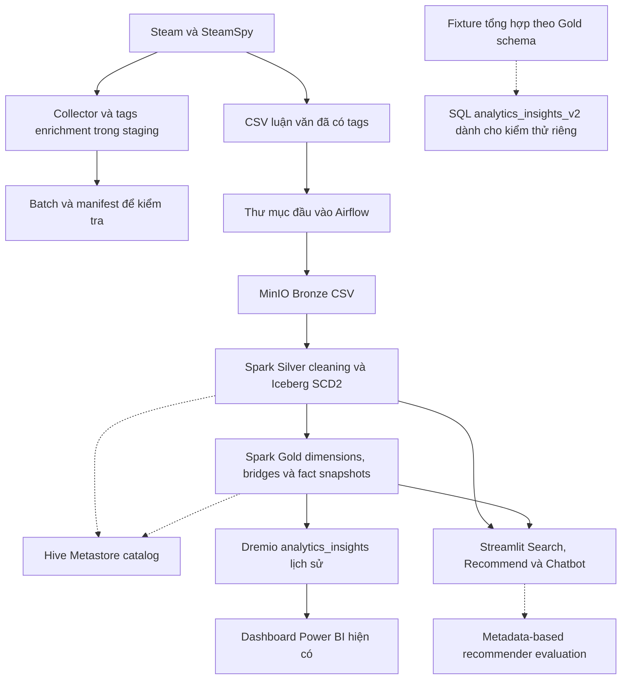

# Kiến trúc và luồng dữ liệu

Sơ đồ thể hiện luồng của luận văn, chức năng staging đã phục hồi và ranh giới kiểm thử SQL V2. Đường nét đứt thể hiện quan hệ catalog, chức năng tùy chọn hoặc đầu vào dùng riêng để kiểm thử.

## Collection và bàn giao

Collector luận văn xuất CSV games 15 cột và thu thập tags ở một sidecar riêng. Header của `data/games.csv` trong thesis workspace có 16 cột, gồm `tags`. Quy trình ban đầu tạo ra file đã enrich chưa được xác minh. Collector hiện tại tái lập hợp đồng 16 cột bằng cách nối theo `steam_appid`. Tags thiếu hoặc xung đột làm enrichment dừng. Trường tương thích `steamspy_players_2weeks` lưu `average_2weeks` theo phút chơi trung bình trong hai tuần.

Collector ghi checkpoint, manifest và hashes cho batch ở staging. Resume và kiểm tra toàn vẹn áp dụng trong batch. Collector thiếu cơ chế bàn giao nguyên tử cả bộ file sang Airflow và không tự động publish vào Bronze. Kiểm thử live API còn pending. [Staging guide](collector-staging.md) · [Bối cảnh luận văn](reference/thesis-context.md)

## Bronze, Silver và Gold

- **Bronze.** DAG `auto_upload_bronze_to_minio` chạy theo lịch `*/2 * * * *`. Task quét thư mục đầu vào đã mount và ghi object vào prefix `bronze/`. Cơ chế này không có file checkpoint hoặc dataset manifest. [DAG](../LakeHouse_Project/airflow/dags/auto_upload_data.py) · [Upload script](../LakeHouse_Project/scripts/rawData_to_bronze.py)
- **Silver.** DAG `schedule=None` đọc `games.csv`, `reviews.csv` và `popularity.csv`. File games phải có sẵn `tags`. Spark chuẩn hóa CSV và ghi Iceberg qua Hive Metastore. SCD2 expire bản hiện hành rồi append phiên bản mới khi tracked fields thay đổi. Thay đổi riêng `tags_cleaned` hoặc `steamspy_players_2weeks` nằm ngoài điều kiện kích hoạt phiên bản mới hiện tại. [DAG](../LakeHouse_Project/airflow/dags/bronze_to_silver_etl.py) · [ETL](../LakeHouse_Project/scripts/bronze_to_silver_etl.py)
- **Gold.** DAG `schedule=None` tạo dimensions và bridges, sau đó cập nhật fact tables. Review và popularity facts phản ánh trạng thái hiện hành theo game. `fact_game` dùng release date và khóa đại diện từ bridges. Các thao tác `DELETE + APPEND` là nhiều lần ghi riêng. Compose cấu hình Spark, MinIO và Hive Metastore với PostgreSQL cho catalog. [DAG](../LakeHouse_Project/airflow/dags/silver_to_gold_etl.py) · [ETL](../LakeHouse_Project/scripts/silver_to_gold_etl.py) · [Compose](../LakeHouse_Project/docker-compose.yml)

Ba DAG có ranh giới trigger riêng. Retry task không tạo transaction bao trùm các lần ghi. Các rủi ro còn lại gồm lỗi đọc Bronze bị xử lý như kết quả rỗng, thiếu dữ liệu đầu vào bị bỏ sót, Silver bị gián đoạn giữa expire và append, và Gold bị gián đoạn giữa delete và append. Characterization tests mô tả hành vi và trường hợp lỗi đã biết. [Reliability audit](reliability-audit.md) · [Test plan](reliability-test-plan.md)

## Analytics và dashboard

Theo Project Owner, Power BI hiện có phụ thuộc các view Dremio lịch sử trong `analytics_insights`. File legacy lưu để đối chiếu contract, gồm cả các giới hạn đã biết về joins, đơn vị và diễn giải lịch sử. SQL V2 định nghĩa 14 view current-state đã chỉnh trong `analytics_insights_v2`. V2 được giữ riêng để kiểm thử, chưa xác nhận deployment. Native execution trên Dremio còn pending. PBIX bindings và khả năng refresh chưa được xác minh độc lập. [SQL guide](sql-analytics.md)

## AI và evaluation

Index builder đọc Gold game/detail và Silver games/reviews hiện hành. Search đối chiếu văn bản trong metadata. Recommend tab dùng FAISS similarity từ một seed. Chatbot hỗ trợ search/recommend bằng hybrid ranking cùng các nhánh compare và analyze. Chroma dùng local persistence, Ollama cung cấp embeddings và có thể tạo phần giải thích. Evaluation mặc định tắt, khi bật dùng metadata pseudo ground truth để đo ranking ở cutoff cố định. Kiểm thử offline không xác nhận kết nối native giữa Streamlit, FAISS, Chroma và Ollama. [Index builder](../LakeHouse_Project/streamlit-ai/src/auto_builder.py) · [AI guide](../LakeHouse_Project/streamlit-ai/AI_FEATURES_DOCUMENT.md) · [Evaluation guide](../LakeHouse_Project/streamlit-ai/evaluation/README_RECOMMENDER_EVALUATION.md)
