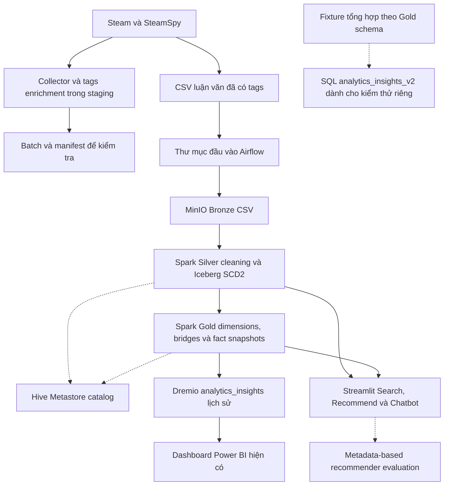

# Kiến trúc và luồng dữ liệu

Sơ đồ thể hiện luồng của luận văn, chức năng staging đã phục hồi và ranh giới kiểm thử SQL V2. Đường nét đứt thể hiện quan hệ catalog, chức năng tùy chọn hoặc đầu vào dùng riêng để kiểm thử.

## Collection và bàn giao

Collector luận văn xuất CSV games 15 cột và thu thập tags ở một sidecar riêng. Header của `data/games.csv` trong thesis workspace có 16 cột, gồm `tags`. Quy trình ban đầu tạo ra file đã enrich chưa được xác minh. Collector hiện tại tái lập hợp đồng 16 cột bằng cách nối theo `steam_appid`. Tags thiếu hoặc xung đột làm enrichment dừng. Trường tương thích `steamspy_players_2weeks` lưu `average_2weeks` theo phút chơi trung bình trong hai tuần.

Collector ghi checkpoint, manifest và hashes cho batch ở staging. Resume và kiểm tra toàn vẹn áp dụng trong batch. Collector thiếu cơ chế bàn giao nguyên tử cả bộ file sang Airflow và không tự động publish vào Bronze. Kiểm thử live API còn pending. [Staging guide](collector-staging.md) · [Bối cảnh luận văn](reference/thesis-context.md)

## Bronze, Silver và Gold

- **Bronze.** DAG `auto_upload_bronze_to_minio` chạy mỗi hai phút (`*/2 * * * *`). Task quét thư mục đầu vào và upsert từng CSV hiện diện lên prefix `bronze/` theo `steam_appid` chuẩn hóa. Task thêm key mới, cập nhật key cũ khi timestamp mới hơn và giữ bản ghi đích khi timestamp cũ hơn hoặc bằng. Nếu không có thay đổi thì bỏ qua ghi. MinIO báo `NoSuchKey` thì khởi tạo object. Lỗi đọc hoặc CSV không qua kiểm tra làm tác vụ thất bại trước khi ghi object đó. Bronze ghi từng object riêng, không có checkpoint hay dataset manifest. [DAG](../LakeHouse_Project/airflow/dags/auto_upload_data.py) · [Upload script](../LakeHouse_Project/scripts/rawData_to_bronze.py)
- **Silver.** DAG đọc `games.csv`, `reviews.csv` và `popularity.csv`. File games phải có sẵn cột `tags`. Spark đọc CSV, pandas chuẩn hóa dữ liệu và Spark ghi Iceberg qua Hive Metastore. Khi refresh incremental, một `MERGE` theo từng bảng kết thúc hiệu lực bản hiện hành đã đổi và chèn phiên bản kế tiếp. Với key đã có bản hiện hành, điều kiện tạo phiên bản mới chỉ so sánh các cột trong `SCD2_CHANGE_COLS` của bảng có mặt trong dữ liệu nguồn. Thay đổi riêng `tags_cleaned` trong games hoặc `steamspy_players_2weeks` trong popularity không kích hoạt phiên bản mới. [DAG](../LakeHouse_Project/airflow/dags/bronze_to_silver_etl.py) · [ETL](../LakeHouse_Project/scripts/bronze_to_silver_etl.py)
- **Gold.** Mỗi fact task chạy sau các dimensions hoặc bridges mà nó cần. Incremental refresh của `dim_game`, `dim_detail_info`, `dim_review_info` và `dim_popularity_info` dùng một Iceberg `MERGE` mỗi bảng và giữ surrogate key đã chọn cho game hiện có. `fact_review_snapshot` và `fact_popularity_snapshot` cũng dùng một `MERGE` mỗi bảng và phản ánh trạng thái hiện hành theo game. Năm bảng `bridge_game_*` và `fact_game_snapshot` vẫn dùng `DELETE` rồi `APPEND` thành hai lần ghi. `fact_game_snapshot` dùng khóa ngày phát hành và bridge SK nhỏ nhất theo game, với `-1` khi thiếu liên kết. Compose cấu hình Spark, MinIO và Hive Metastore với PostgreSQL cho catalog. [DAG](../LakeHouse_Project/airflow/dags/silver_to_gold_etl.py) · [ETL](../LakeHouse_Project/scripts/silver_to_gold_etl.py) · [Compose](../LakeHouse_Project/docker-compose.yml)

Silver và Gold có `schedule=None` và cần trigger riêng. Ba DAG trong repository không tự kích hoạt lẫn nhau. Các DAG cấu hình một lần retry sau năm phút. Ranh giới commit của `MERGE` là từng bảng. Retry có thể chạy lại một task đã ghi dở dang. Các đường ghi trên được đối chiếu với source. Kiểm thử offline dùng mocks hoặc dữ liệu tổng hợp. Bằng chứng native giới hạn ở từng kịch bản cô lập. [Native validation của dim_game](gold-game-dimensions-atomic-recovery.md) · [Audit lịch sử](reliability-audit.md) · [Test plan](reliability-test-plan.md)

## Analytics và dashboard

Theo Project Owner, Power BI hiện có phụ thuộc các view Dremio lịch sử trong `analytics_insights`. File legacy lưu để đối chiếu contract, gồm cả các giới hạn đã biết về joins, đơn vị và diễn giải lịch sử. SQL V2 định nghĩa 14 view current-state đã chỉnh trong `analytics_insights_v2`. V2 được giữ riêng để kiểm thử, chưa xác nhận deployment. Native execution trên Dremio còn pending. PBIX bindings và khả năng refresh chưa được xác minh độc lập. [SQL guide](sql-analytics.md)

## AI và evaluation

Index builder đọc Gold game/detail và Silver games/reviews hiện hành. Search đối chiếu văn bản trong metadata. Recommend tab dùng FAISS similarity từ một seed. Chatbot hỗ trợ search/recommend bằng hybrid ranking cùng các nhánh compare và analyze. Chroma dùng local persistence, Ollama cung cấp embeddings và có thể tạo phần giải thích. Evaluation mặc định tắt, khi bật dùng metadata pseudo ground truth để đo ranking ở cutoff cố định. Kiểm thử offline không xác nhận kết nối native giữa Streamlit, FAISS, Chroma và Ollama. [Index builder](../LakeHouse_Project/streamlit-ai/src/auto_builder.py) · [AI guide](../LakeHouse_Project/streamlit-ai/AI_FEATURES_DOCUMENT.md) · [Evaluation guide](../LakeHouse_Project/streamlit-ai/evaluation/README_RECOMMENDER_EVALUATION.md)
